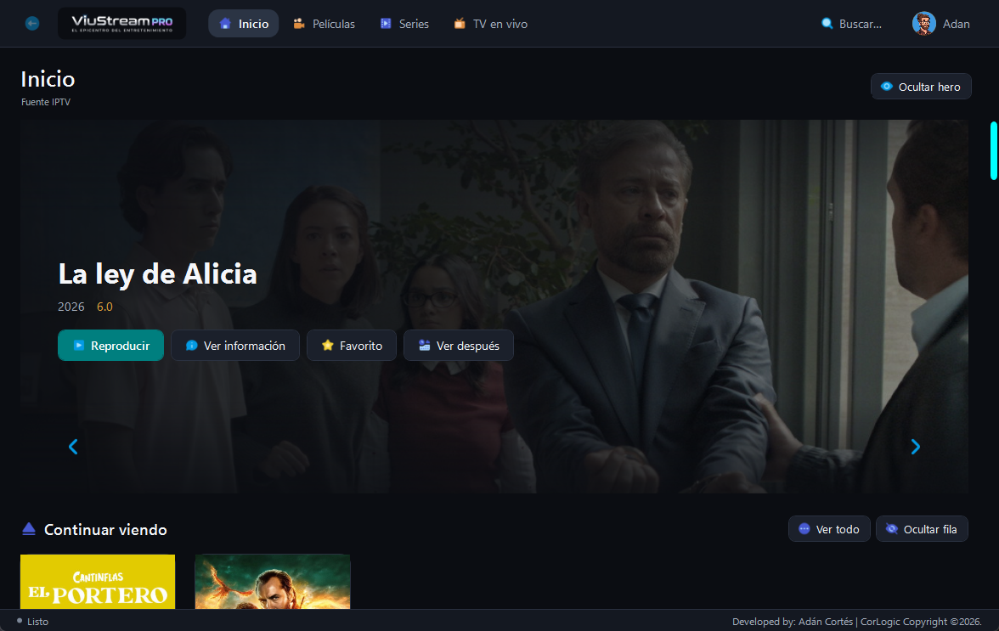
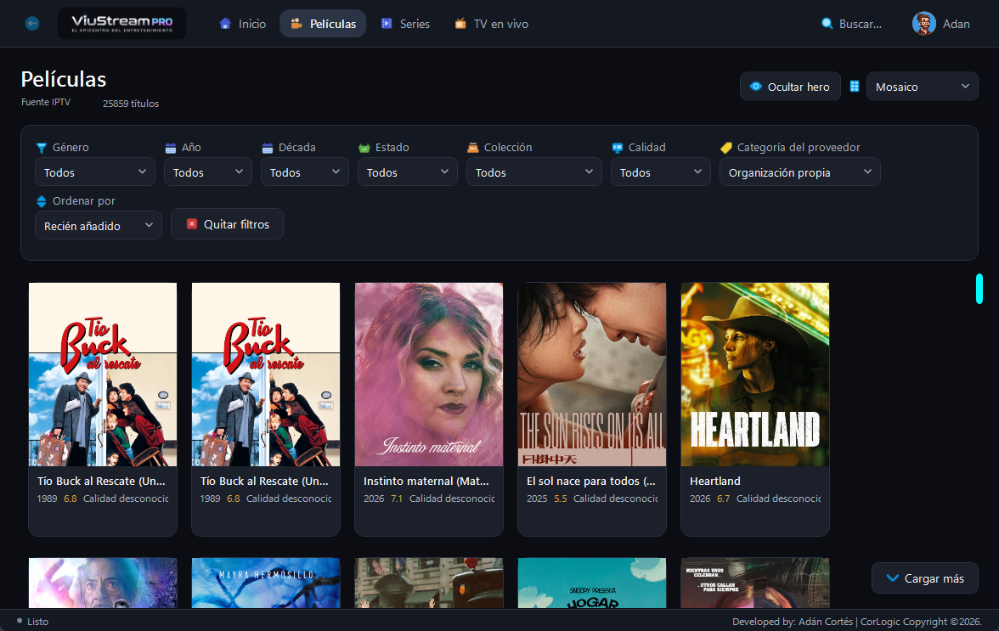
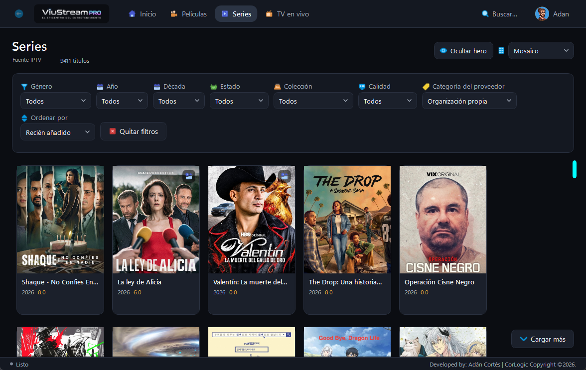
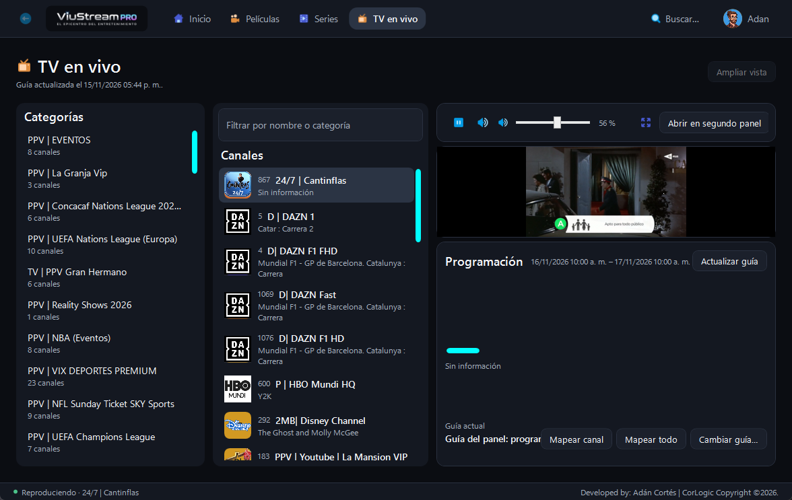

# 🎬 ViuStream Pro

**Tu suscripción IPTV, ordenada como una aplicación de escritorio.**

📺 TV en vivo con guía · 🎞️ Películas y series · 👤 Hasta 5 perfiles · 🌐 Español e inglés

## 📦 Versión actual

| Campo | Valor |
| --- | --- |
| Versión | **0.3.0** |
| Fecha | 16 de noviembre de 2026 |
| Canal | Estable |
| Descarga | [Última versión publicada](https://github.com/adancortes-ing/viustream-releases/releases/latest) |
| Historial | [Registro de cambios](CHANGELOG.md) |

## 🔄 Actualización

ViuStream Pro comprueba si hay una versión nueva al arrancar y, cuando quieras, desde
**Ajustes → Actualizaciones → Comprobar ahora**. La aplicación descarga el instalador del canal
estable, verifica el hash SHA-256 y la firma Authenticode, y solo entonces lo aplica: al cerrar
la aplicación o con **Reiniciar y actualizar**, nunca durante una reproducción. La actualización
no toca tus datos: se conservan los perfiles, el catálogo, las listas y el progreso. Si la
descarga o la instalación fallan, sigues en la versión actual y puedes reintentar.

> Esta versión, **0.3.0**, se instala sobre **0.2.0** sin desinstalar antes y sin perder datos.

## 🏷️ Etiquetas

`#IPTV` `#Windows` `#VOD` `#Series` `#TVEnVivo` `#MediaPlayer` `#EPG` `#M3U` `#Xtream`
`#PlayerAPI` `#ReproductorDeVídeo` `#SoftwareDeEscritorio`. Estas son las *topics* del repositorio.

## 🎯 Descripción

ViuStream Pro es una aplicación de escritorio para Windows que ordena **tu propia suscripción
IPTV**: canales, películas y series en un catálogo local, con perfiles, listas y una
reproducción pensada para el uso diario.

No incluye contenido, listas ni credenciales. Tú aportas la fuente y la aplicación se encarga
de organizarla, mantenerla al día y recordar por dónde ibas.

## ✨ Características principales

- 📡 **TV en vivo** con guía de programación (ahora y siguiente), favoritos, historial y
  pantalla dividida con audio A, audio B o mezcla.
- 🎞️ **Películas y series** con fichas, versiones, sagas, progreso y siguiente episodio.
- 🔍 **Búsqueda global** por tipo —Todo, Películas, Series y TV— con filtros propios.
- ⚙️ **Descubrimiento configurable**: de 3 a 10 filas por géneros normalizados o por categorías
  del proveedor en Inicio, Películas y Series, con rotación diaria, por arranque o fija.
- 🧩 **Tres formas de ver el catálogo**: filas horizontales, mosaico y lista detallada con
  sinopsis, dirección, reparto y progreso.
- 🎛️ **Filtros contextuales** que se aplican solos al cambiar de criterio, con Año y Década
  excluyentes y un «Quitar filtros» que lo devuelve todo a su sitio.
- 👤 Hasta **5 perfiles locales**, con un PIN parental único, perfil infantil y visibilidad
  adaptada a cada perfil.
- ▶️ **Reanudación** precisa, «Continuar viendo», favoritos, ver después y marcas de visto que
  se reflejan al instante en Inicio.
- 🎚️ Reproducción de **MKV, MP4, AVI, TS y HLS**, con pistas de audio múltiples y subtítulos.
- 📴 Navegación del catálogo **sin conexión**; solo la reproducción necesita red.
- 💾 **Copias de seguridad y exportación** de tus datos, siempre sin credenciales.
- 🌐 Interfaz en **español e inglés**, tema oscuro o claro, alto contraste y reducción de
  movimiento; **sin telemetría**.

## 🧩 Módulos

| Módulo | Qué resuelve |
| --- | --- |
| 🏠 Inicio | Hero editorial, continuar viendo, favoritos y filas de descubrimiento |
| 🎬 Películas | Catálogo, filtros, orden, sagas y versiones |
| 📺 Series | Series, temporadas, episodios y progreso |
| 📡 TV en vivo | Canales, guía, favoritos, historial y reproducción |
| 🪟 Pantalla dividida | Dos canales a la vez con audio A, B o mezcla |
| 🔍 Búsqueda | Búsqueda global por tipo y filtros |
| 👤 Perfiles | Identidades locales, PIN y control parental |
| ⚙️ Ajustes | Fuentes, guía, reproducción, descubrimiento, almacenamiento y actualizaciones |
| 🔄 Actualizaciones | Aviso de versión nueva, descarga verificada y aplicación al cerrar |

## 🖼️ Capturas

| Inicio | Películas |
| :---: | :---: |
|  |  |
| Hero, continuar viendo y filas configuradas | Catálogo con filtros y cambio de vista |

| Series | TV en vivo |
| :---: | :---: |
|  |  |
| Series, temporadas y progreso | Canales, guía y pantalla dividida |

## 🚀 Instalación

### Requisitos

- Windows 10 22H2 o Windows 11, en 64 bits.
- Conexión a Internet para descargar la aplicación y para reproducir. El catálogo ya
  sincronizado se puede navegar sin conexión.

### Elige el instalador

| Instalador | Para quién | Permisos |
| --- | --- | --- |
| `ViuStreamPro-0.3.0-user-x64.msi` | Solo tu cuenta de Windows | No pide administrador |
| `ViuStreamPro-0.3.0-machine-x64.msi` | Todos los usuarios del equipo | Pide UAC |

### Pasos

1. Abre [Releases](https://github.com/adancortes-ing/viustream-releases/releases/latest) y
   descarga el MSI que corresponda a tu caso.
2. Comprueba que el archivo pertenece a la release 0.3.0 y que su SHA-256 coincide con el
   publicado en `update.json` (adjunto en la misma release).
3. Ejecuta el MSI y sigue el asistente. La instalación por usuario no necesita permisos de
   administrador; la instalación por máquina pedirá elevación.
4. Abre ViuStream Pro y completa la primera configuración: crea tu perfil (el primero es
   adulto), añade tu fuente IPTV (Xtream / Player API o una lista M3U) y deja que termine la
   primera sincronización. Después podrás crear más perfiles y configurar el PIN parental.

### Firma y verificación

Los instaladores y ejecutables se publican firmados con Authenticode, y cada archivo tiene su
SHA-256 en el manifiesto de actualización. No instales un paquete con firma no válida o hash
distinto del publicado.

> En esta etapa la firma usa un certificado de pruebas, no público: Windows puede mostrar
> «Editor desconocido» o avisos de SmartScreen. Antes de continuar, verifica el SHA-256 publicado.

### Desinstalación

Usa **Aplicaciones instaladas** de Windows o el acceso **Desinstalar ViuStream Pro**. El
desinstalador pregunta si quieres borrar tus datos: por defecto los conserva (perfiles,
catálogo, listas y progreso); si aceptas borrarlos, se eliminan los de la cuenta que desinstala.

## 💬 Soporte

Las incidencias de la aplicación se atienden en
[Issues de viustream-releases](https://github.com/adancortes-ing/viustream-releases/issues).

Al abrir una incidencia, incluye:

- Versión de ViuStream Pro (la ves en **Ajustes → Actualizaciones**).
- Versión de Windows y arquitectura del equipo.
- Pasos para reproducir el problema y qué esperabas que ocurriera.
- Capturas o mensajes de error, **sin credenciales ni datos personales**.

No se atienden problemas de contenido, emisión o suscripción del proveedor: esta aplicación no
distribuye canales ni credenciales.

## 📄 Licencia

ViuStream Pro es software propietario. © 2026 ViuStream. Todos los derechos reservados.

Este repositorio solo distribuye binarios firmados y el manifiesto de actualización. No se
concede licencia alguna para reutilizar, modificar ni redistribuir el código de la aplicación.

ViuStream Pro no proporciona contenido, listas ni credenciales. Solo reproduce fuentes que el
usuario posee o tiene derecho a usar; el cumplimiento de las condiciones del proveedor es
responsabilidad del usuario.
